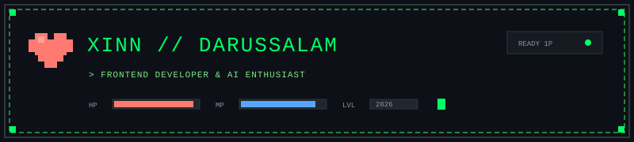

<div align="center">

  

  <p align="center">
    
    
    
  </p>

</div>

---

### 🕹️ [CHARACTER SHEET]

```text
┌─────────────────────────────────────────────────────────────────┐
│ NAME     : Darussalam (xinn / ds-xinn)                          │
│ CLASS    : Frontend Web Developer & AI Enthusiast               │
│ LEVEL    : 2026.1                                               │
│ LOCATION : Indonesia                                            │
│ MISSION  : Building lightweight, interactive & deterministic web│
│ PASSIVE  : Pixel Precision, Zero Server Reliance                │
└─────────────────────────────────────────────────────────────────┘
```

---

### 🎒 [INVENTORY & SKILL ARSENAL]

<table>
  <tr>
    <td width="25%" valign="top">
      <b>⚔️ Primary (Frontend)</b>
      <br/><br/>
      • HTML5 & Semantic Web<br/>
      • CSS3 & Modern Layouts<br/>
      • JavaScript (ES2022+)<br/>
      • TypeScript
    </td>
    <td width="25%" valign="top">
      <b>🛡️ Core Languages & Backend</b>
      <br/><br/>
      • Golang<br/>
      • PHP<br/>
      • Ruby
    </td>
    <td width="25%" valign="top">
      <b>🔮 AI & Client Runtimes</b>
      <br/><br/>
      • Generative AI & LLM Logic<br/>
      • WebAssembly (Wasm)<br/>
      • Web Audio API (DSP)<br/>
      • Canvas & Client PDF Processing
    </td>
    <td width="25%" valign="top">
      <b>📦 Tools & Ecosystem</b>
      <br/><br/>
      • Git & GitHub<br/>
      • Vite & Node.js<br/>
      • VS Code & DevTools<br/>
      • Linux / Windows CLI
    </td>
  </tr>
</table>

---

### 🏆 [FLAGSHIP QUEST / PROJECT]

<table>
  <tr>
    <td>
      <h3>⚡ <a href="https://darussaalam.github.io/">Cnv-Mu File Studio</a></h3>
      <p>
        Suite utilitas dokumen dan manipulasi file PDF/Office 100% berbasis client-side browser tanpa dependensi server.
      </p>
      <ul>
        <li><b>Zero Cloud Egress:</b> Privasi penuh, file tidak pernah diunggah ke server eksternal.</li>
        <li><b>High Performance:</b> Ditenagai WebAssembly, HTML5 Canvas, PDF.js, PDF-Lib, SheetJS, dan Web Audio sintetis.</li>
        <li><b>Live Demo:</b> <a href="https://darussaalam.github.io/">darussaalam.github.io</a></li>
      </ul>
    </td>
  </tr>
</table>

---

### 📊 [STATISTICS & TELEMETRY]

<div align="center">


<br/>


</div>

---

### 👾 [RETRO TERMINAL / GET IN TOUCH]

```bash
xinn@portfolio:~$ ping -c 1 darussalam
64 bytes from darussalam: icmp_seq=1 ttl=64 time=0.042 ms
xinn@portfolio:~$ echo "Let's build something awesome together!"
```

<div align="center">

[](https://github.com/darussaalam)
[](https://darussaalam.github.io/)

<sub>Crafted with pixel precision. No generic AI templates.</sub>

</div>
